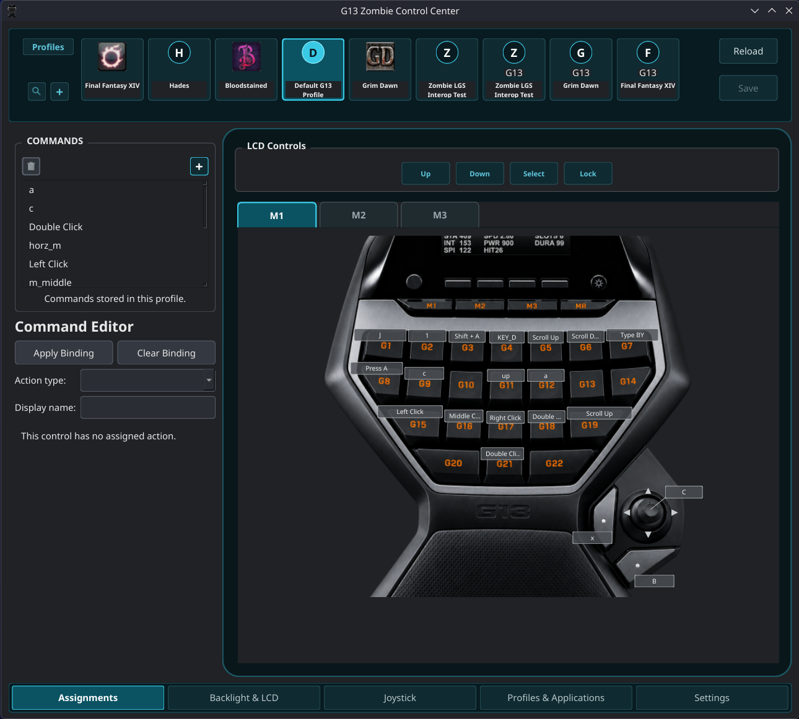
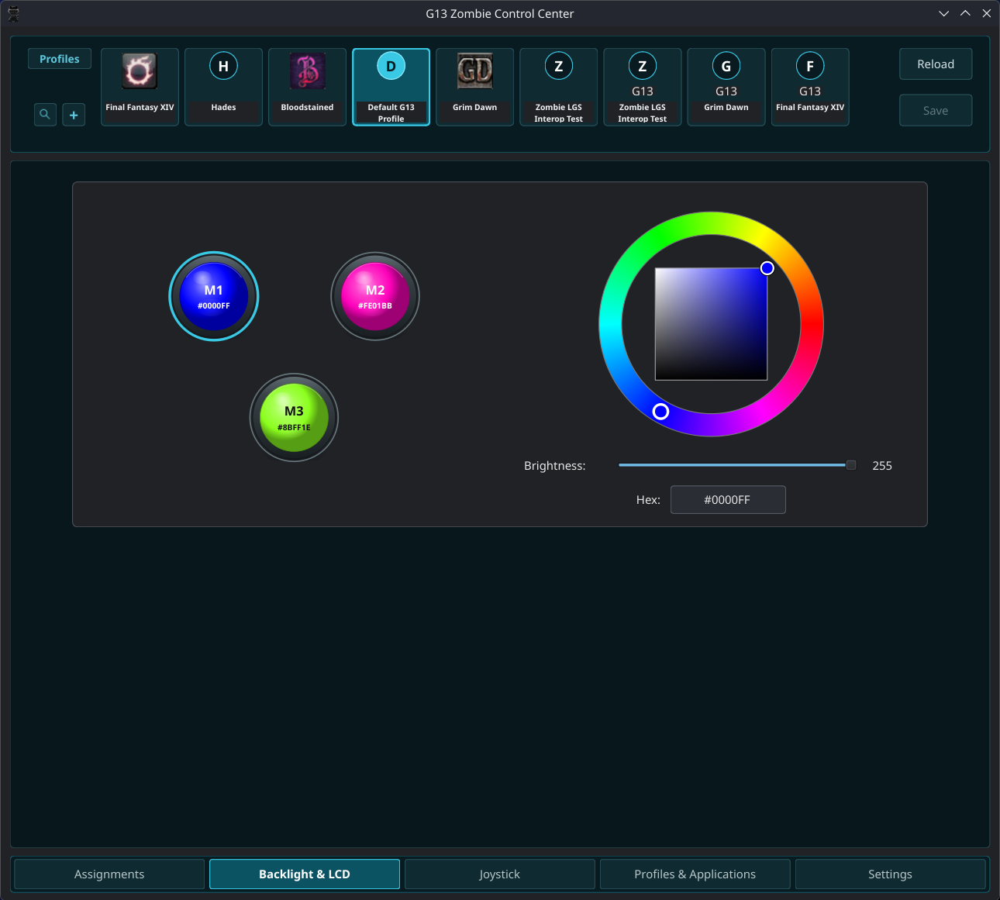
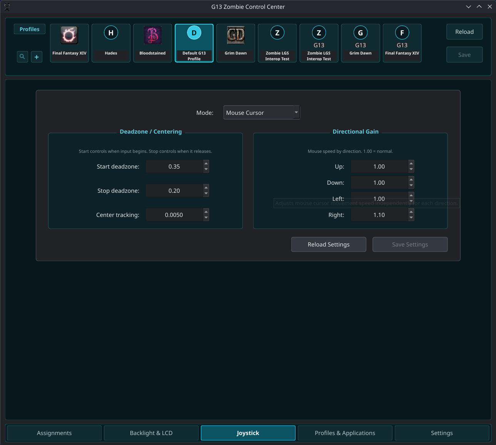
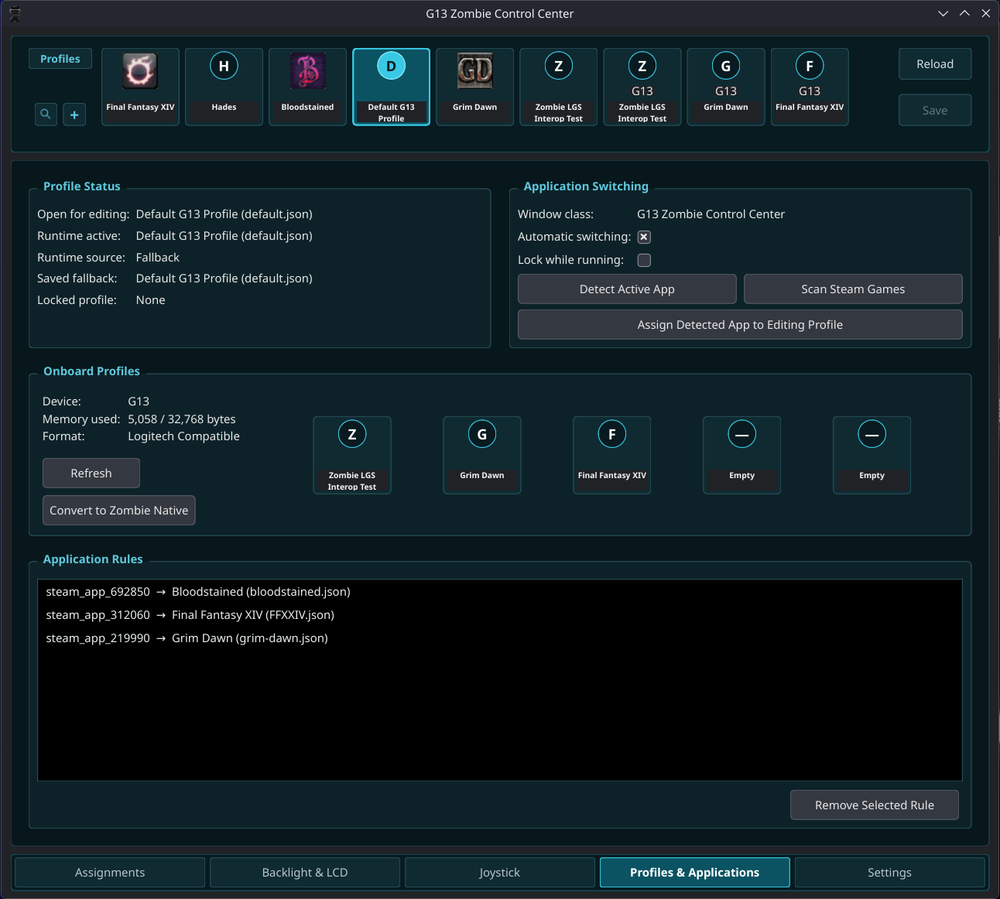

# G13 Zombie Control Center
G13 Zombie Control Center is a Linux control center for the Logitech G13 gamepad.

Current release: **1.0.0**

Zombie provides profile management, programmable G-keys, macros,
backlighting, LCD support, joystick configuration, application-based
profile switching, onboard profile storage, Logitech profile
interoperability, Lua scripting, and diagnostic tools.

# Screenshots

## Assignments

## Backlight & LCD

## Joystick

## Profiles & Applications

# Features
- Profile-specific G-key assignments
- Reusable command library
- Keyboard, mouse, wheel, and macro actions
- Quick macro recording with the physical MR key
- M1, M2, and M3 profile layers
- Profile-specific backlight colors
- G13 LCD profile navigation and runtime status
- Joystick key-binding mode
- Joystick mouse-cursor mode
- Automatic application profile switching
- Temporary profile activation
- Manual profile locking
- Zombie Native onboard profile storage
- Logitech-compatible onboard profile conversion
- Logitech XML profile import and export
- Profile-specific Lua scripting
- Steam game scanning
- LCD and LED hardware tests
- Diagnostic report generation

# Tested environments

For this release, the primary full-regression environment was:

- Bazzite 43 with KDE/Wayland and Steam Gaming Mode/Gamescope

Additional installation and runtime portability testing was completed on:

- Bazzite 44 with KDE/Wayland
- Linux Mint 22.3 with XFCE/X11
- Linux Mint 22.3 with Cinnamon/X11
- Debian 13 with Cinnamon/X11
- Fedora Workstation 44
- Fedora Silverblue 44 with GNOME/Wayland

Other Linux environments may work, but they have not been validated for
this release.

The production runtime uses a rootless Fedora 44 Distrobox container so
it remains isolated from the host Python environment.

# Installation
Complete installation instructions are available in:

`docs/INSTALL.md`

The installation guide covers:

- Required host software
- Bazzite input permissions
- Application installation
- Desktop and application-menu integration
- Driver-service installation
- Steam Gaming Mode setup
- Updates and rollback
- Diagnostics
- Uninstallation

# Launching Zombie
After installation, G13 Zombie Control Center can be launched from the
desktop application menu.

It can also be started directly with:

    ~/.local/bin/zombiecc

The editor does not need to remain open for normal G13 operation.
The G13 driver runs independently as a systemd user service.

## Gaming Mode display size

In Steam Gaming Mode, the Zombie editor uses a fixed presentation size
and cannot be resized like a normal desktop window.

If the editor appears too large or too small for the display, adjust the
Steam/Gamescope display scaling or game-resolution settings rather than
trying to resize the Zombie editor itself.

# User data
Zombie keeps user data separate from the installed application.

Profiles are stored under:

`~/.local/share/zombiecc/profiles`

Configuration is stored under:

`~/.config/zombiecc`

Logs, diagnostics, update backups, and other application state are stored
under:

`~/.local/state/zombiecc`

# Application files
The installed application and managed Python runtime are stored under:

`~/.local/share/zombiecc/app`

The production Distrobox container is named:

`zombiecc`

The normal host launcher is:

`~/.local/bin/zombiecc`

# Profiles
Zombie supports multiple profiles with independent:

- G-key assignments
- Commands
- Macros
- M1, M2, and M3 bindings
- Backlight colors
- Joystick settings
- Lua scripts
- Application switching rules

Profiles can be selected manually or activated automatically based on the
active application.

# Onboard profiles
Zombie supports the G13's onboard profile storage.

Zombie Native profiles use Zombie's own onboard format.

Onboard profiles can also be converted to and from a Logitech-compatible
format for interoperability.

# Logitech profile compatibility
Zombie supports importing Logitech XML profiles.

Profiles can also be exported in Logitech XML format.

Imported profiles are converted into Zombie's profile system while
preserving supported assignments and relationships.

# LCD support
Zombie supports the G13's 160 x 48 monochrome LCD.

The LCD can display:

- Zombie startup splash
- Runtime profile information
- Profile navigation
- Profile selection state

The physical LCD buttons can be used for profile navigation and profile
activation.

# Joystick support
The G13 joystick can operate in:

- Key Bindings mode
- Mouse Cursor mode

Joystick settings are stored per profile.

# Application switching
Zombie can automatically switch profiles based on the active application.

The runtime also supports:

- Temporary profile activation
- Manual profile locking
- Automatic application-based switching

# Lua scripting
Zombie provides profile-specific Lua scripting with Logitech-style
functionality.

Supported scripting features include keyboard, mouse, profile, timing,
and physical input-state functions.

Some physical input-state features require permission to read Linux input
devices. See `docs/INSTALL.md` for the required Bazzite setup.

# Diagnostics
Diagnostic and hardware-test tools are available under:

`Settings > Developer`

Available tools include:

- Test LCD
- Test LEDs
- Verify onboard writes
- Generate Diagnostic Report

Diagnostic reports are saved under:

`~/.local/state/zombiecc/diagnostics`

The reports contain application and runtime information useful for
troubleshooting without including profile contents, macros, application
rules, or settings values.

# Updates
Zombie includes a controlled application updater.

From the newly extracted release directory, updates can be previewed
before being applied:

    python3 update_app.py --dry-run

The updater verifies the installed application, creates a rollback backup,
and preserves user profiles and configuration.

Full update and rollback instructions are available in:

`docs/INSTALL.md`

# Uninstalling
Zombie includes a production uninstaller.

A normal uninstall removes the managed application, launcher, desktop
integration, production driver service, and production Distrobox container
while preserving user profiles, configuration, logs, diagnostics, and
update backups.

Uninstall instructions are available in:

`docs/INSTALL.md`

# Production runtime
Technical information about the production Fedora container, Python
environment, dependencies, and runtime isolation is documented in:

`docs/RUNTIME.md`

# License

Copyright (C) 2026 Powers

G13 Zombie Control Center is free software: you can redistribute it and/or
modify it under the terms of the GNU General Public License as published by
the Free Software Foundation, either version 3 of the License, or (at your
option) any later version.

See `LICENSE` for the full license text.

# Logitech notice
G13 and Logitech are trademarks or product names of Logitech.

G13 Zombie Control Center is an independent project and is not affiliated
with or endorsed by Logitech.
